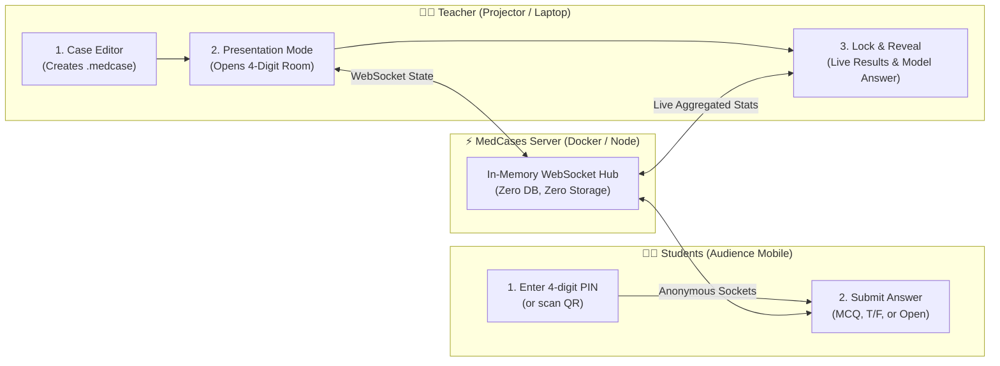

# MedCases

An interactive, privacy-focused clinical case teaching and audience response platform designed for medical, dental, and healthcare education.

MedCases empowers instructors to present clinical patient scenarios, medical imaging, and real-time interactive questions in lecture halls and small-group sessions—while students participate anonymously using their phones or laptops without accounts, downloads, or logins.

---

## Key Highlights

- 🖥️ **Lecture Hall Presentation Engine**:
  - **1:1 WYSIWYG Parity**: What you create in the editor renders with pixel-perfect aspect ratio (16:9 dynamic canvas clamping) on projector screens.
  - **Takariviluettavuus (Back-Row Readability)**: High-contrast typography (Inter) with dynamic font scaling guarantees legibility from the back of large 200+ seat auditoriums.
  - **Hardware Clicker & Remote Support**: Full navigation support for wireless presentation remotes and keyboards (`Arrow` keys, `PageUp`/`PageDown`, `Space`/`Enter` to reveal answers, `F` for fullscreen, `Tab` for sidebar).
  - **Medical Image Lightbox**: Instant full-screen zoom for radiographs, CT scans, ECGs, and histology slides with keyboard `Escape` dismissal.

- 📱 **Frictionless Student Participation**:
  - **No Registration or App Download**: Students simply join via a 4-digit room code or QR code on any device with a modern browser.
  - **Touch Ergonomics**: Zero 300ms mobile tap delay (`touch-action: manipulation`), large tactile cards, and instant visual feedback.
  - **Network Resilience & Pull-to-Refresh Tolerance**: Room state is preserved across accidental browser reloads or temporary campus Wi-Fi drops.

- 📊 **WCAG AA Accessible Data Visualization**:
  - High-contrast animated voting distribution bars.
  - Color-independent indicators (explicit `CheckCircle2` and text ribbon badges) complying with WCAG 1.4.1 for color-blind accessibility.
  - Jitter-free UI design with frozen card dimensions between question and reveal states.

- 🔒 **Zero Database & Privacy by Design (GDPR Compliant)**:
  - **No Database to Maintain**: Eliminates complex database setups, backups, and schema migrations.
  - **Zero PII**: No student names, emails, or personal identifiers are collected or stored.
  - **Offline-First `.medcase` Files**: Patient cases and high-resolution images are packaged as portable ZIP archives stored safely on your own computer.

- 🌍 **Multilingual**: Native full-interface support for **Finnish (Suomi)**, **Swedish (Svenska)**, and **English**, complete with an interactive language slider.

---

## How It Works



### For Instructors
1. **Prepare**: Build an interactive case in the built-in Editor, or load an existing `.medcase` file.
2. **Launch**: Click **"Esitä potilastapauksia / Present Cases"** and select your `.medcase` file. The presentation opens immediately with a 4-digit Room PIN and on-screen QR code.
3. **Present**: Navigate through patient history, lab values, and imaging.
4. **Interact**: When a question slide appears, students answer in real time. Click **"Lukitse ja paljasta / Lock & reveal"** (or hit `Space`) to reveal answer distributions and correct answers.
5. **Multi-Case Sessions**: Pick subsequent patient cases directly from the presenter sidebar without students needing to reconnect.

### For Students
1. **Join**: Open the web application on your smartphone or scan the projector QR code.
2. **PIN**: Enter the 4-digit code shown on screen.
3. **Engage**: Tap your answer and follow the live discussion on the main screen.

---

## Tech Stack

- **Client**: React 19, TypeScript, Vite, Tailwind CSS, Lucide Icons, `i18next`, `@dnd-kit` (drag & drop reordering), `JSZip` (local image extraction).
- **Server**: Node.js, Express, Socket.io (real-time low-latency synchronization), Winston (structured JSON logging).
- **Containerization & Proxy**: Docker (multi-stage Alpine runner), Caddy 2 (automatic HTTPS & Let's Encrypt).

---

## Quick Start (Local Development)

### Prerequisites
- Node.js >= 20.x
- npm >= 10.x

### Installation & Run

1. Clone the repository and install dependencies:
   ```bash
   git clone https://github.com/paunoko/medcases.git
   cd medcases
   npm install
   ```

2. Start development servers (Vite frontend + Socket.io backend concurrently):
   ```bash
   npm run dev
   ```

3. Open your browser:
   - **Frontend**: [http://localhost:5173](http://localhost:5173)
   - **Backend Server**: [http://localhost:3000](http://localhost:3000)

---

## Production Deployment (1-Minute Setup)

MedCases is packaged as a unified Docker container and includes a turnkey `docker-compose.yml` with **Caddy** for automatic HTTPS.

1. **Configure your domain:**
   ```bash
   cp .env.example .env
   ```
   Set your public domain in `.env`:
   ```ini
   DOMAIN=medcases.your-university.edu
   ACME_EMAIL=admin@your-university.edu
   ```

2. **Launch with Docker Compose:**
   ```bash
   docker compose up -d
   ```

3. Open `https://medcases.your-university.edu` in your browser. Caddy automatically provisions and renews SSL certificates from Let's Encrypt.

👉 For detailed institutional hosting guidelines, Nginx reverse proxy examples, and capacity benchmarks, see [DEPLOYMENT.md](DEPLOYMENT.md).

---

## Documentation

- 🚀 [Deployment & Production Guide](DEPLOYMENT.md) – Hardware sizing, capacity benchmarks, and institutional IT checklist.
- 📥 [Data Format Description](data-description.md) – File structure and JSON schema of `.medcase` archives.
- 📂 [Project Structure](project-structure.md) – Directory organization and component hierarchy.
- ✅ [Task Checklist & Changelog](TODO.md) – Comprehensive task tracking and architecture log.

---

## License

This project is licensed under the [GNU General Public License v3.0](LICENSE).
